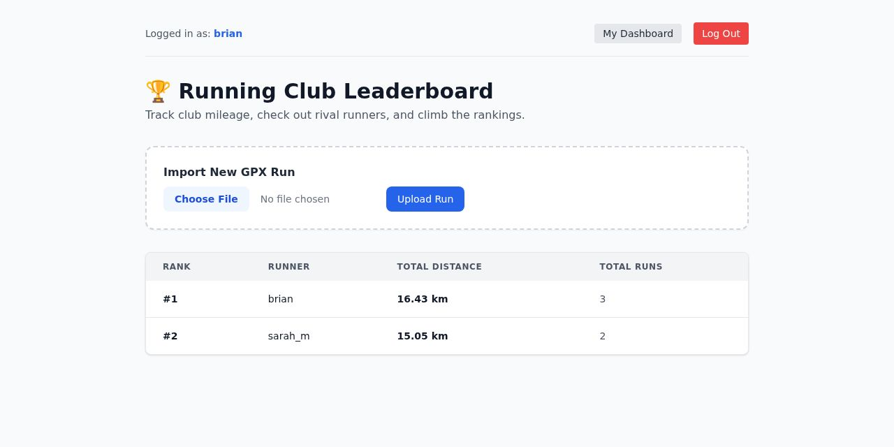
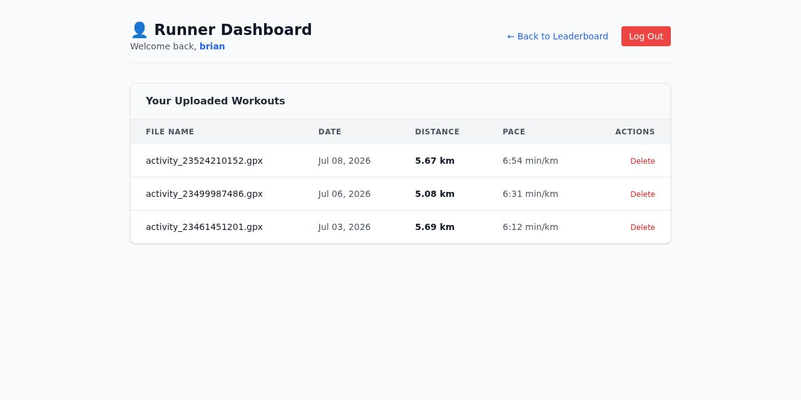

# 🏃‍♂️ Running Club & Leaderboard Portal

A full-stack web application built with Django that lets runners create accounts, upload raw `.gpx` workout files, track their personal running history, and compete on a live club leaderboard.

_A Django evolution of [Running_Man](https://github.com/bchakanyuka/Running_Man), my earlier FastAPI running tracker._

## ✨ Key Features

- **Multi-User Authentication** - Secure registration, login, and session management using Django's built-in password hashing and authentication views.
- **Automated GPX File Parsing** - Uses `gpxpy` to parse raw XML GPS files, automatically extracting timestamps, total distance, and duration, and calculating average pace per kilometer.
- **ORM Aggregation & Leaderboard** - Ranks runners by total club mileage using Django ORM `Sum` and `Count` annotations.
- **Personal Runner Dashboard** - Authenticated users get a private dashboard to view their run history and securely delete past uploads.
- **Modern UI Styling** - Clean, responsive leaderboard and dashboard pages built with Tailwind CSS.

## 🛠️ Tech Stack

- **Backend:** Python, Django
- **Database:** SQLite
- **Data Processing:** `gpxpy`
- **Frontend:** HTML5, Tailwind CSS (via CDN)
- **Security:** Django Auth, CSRF protection, `@login_required` decorators

## 📸 Screenshots

### Live Leaderboard

The club leaderboard ranks every runner by total mileage, with GPX import built into the page.



### Personal Runner Dashboard

Each runner gets a private dashboard with their full upload history, pace per run, and secure deletion.



## 🚀 Getting Started Locally

Follow these steps to set up and run the project on your machine.

### 1. Clone the Repository

```bash
git clone https://github.com/bchakanyuka/running-club.git
cd running-club
```

### 2. Create and Activate a Virtual Environment

```bash
python -m venv venv

# macOS/Linux
source venv/bin/activate

# Windows
venv\Scripts\activate
```

### 3. Install Dependencies

```bash
pip install -r requirements.txt
```

### 4. Configure Environment Variables

Create a `.env` file in the root directory and add your settings:

```env
SECRET_KEY=your-django-secret-key-here
DEBUG=True
```

### 5. Run Database Migrations

```bash
python manage.py makemigrations
python manage.py migrate
```

### 6. Create a Superuser (Optional)

```bash
python manage.py createsuperuser
```

### 7. Start the Development Server

```bash
python manage.py runserver
```

Open your browser and go to [http://127.0.0.1:8000/](http://127.0.0.1:8000/).

## 💡 Project Architecture Highlights

- **Post/Redirect/Get Pattern** - Prevents duplicate form submissions and accidental re-uploads when refreshing the page after parsing a `.gpx` file.
- **Security Safeguards** - Ownership validation ensures users can only delete their own workout entries.
